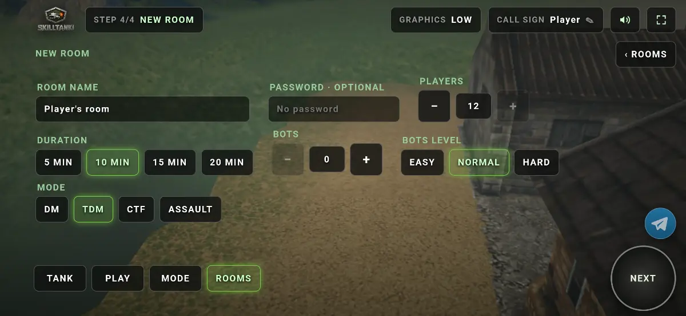
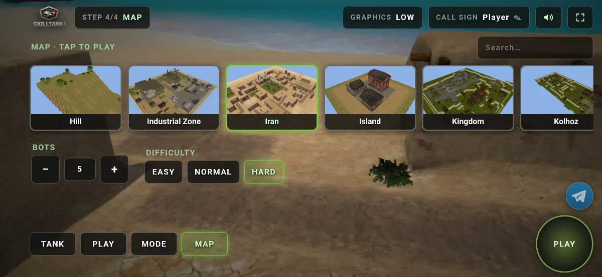
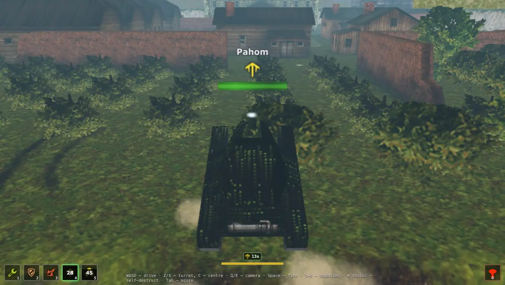
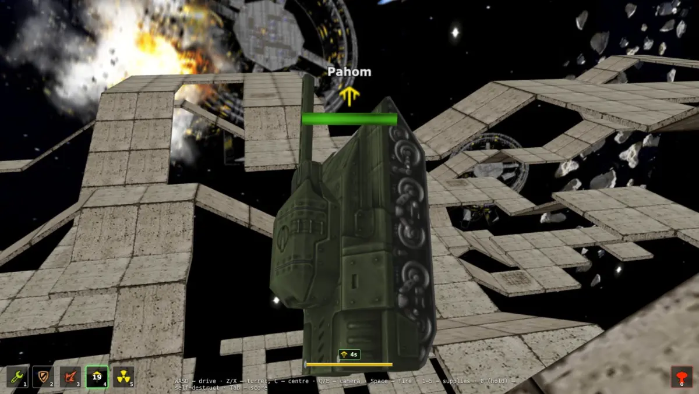
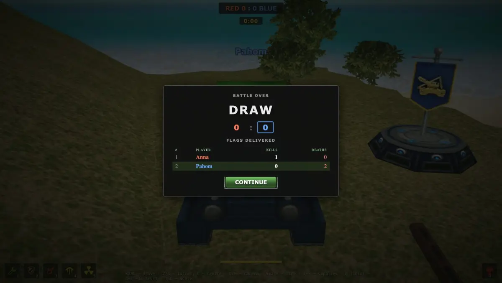

# SkillTanki Landing

Landing page for **SkillTanki**, a free browser tank arcade in the spirit of the 2010 classic. No registration, no pay-to-win, nothing to install.

The site is a single static page built with Next.js and exported as plain HTML, ready to be hosted on GitHub Pages or any static file server.

## Screenshots

### Mobile (PWA)

| Battle: joystick, Fire and supplies | Garage: hulls and turrets |
| --- | --- |
|  |  |

| New room: mode, bots, password | Map selection |
| --- | --- |
|  |  |

### Desktop

| Beach map | Deck 9 in space | City map with ramps | Red versus blue on the hills | Supplies bar in battle |
| --- | --- | --- | --- | --- |
|  |  |  |  |  |

| Battle over scoreboard | Tank selection | Map selection | Deathmatch: solo or multiplayer | Open battles list |
| --- | --- | --- | --- | --- |
|  |  |  |  |  |

## What the page covers

The page is one scrolling layout with anchored sections:

| Section    | Anchor       | Content                                                                 |
| ---------- | ------------ | ----------------------------------------------------------------------- |
| Hero       | `#top`       | Headline, short pitch, Play button, key numbers (7 hulls, 9 turrets, 101 paints, 91 maps) |
| Why        | `#why`       | The problems the game solves: lost Flash game, pay-to-win, grind, accounts, no place to play with friends |
| Modes      | `#modes`     | Deathmatch, Team Deathmatch, Capture the Flag, Assault, Explore Map; public and private rooms |
| Tanks      | `#tanks`     | Seven hulls (Wasp to Mammoth) and nine turrets (Smoky to Shaft)         |
| Maps       | `#maps`      | 91 battlefields and 101 paints                                          |
| Controls   | `#controls`  | Keyboard-only layout: WASD / arrows, Space to fire, 1–5 for supplies, Tab for scoreboard |
| Mobile     | `#mobile`    | Installable PWA with touch controls, no app store required              |
| Gamepad    | `#gamepad`   | Controller and Steam Deck support in the mobile PWA                     |
| Play       | `#play`      | Final call to action with a one-line summary                            |

The Play buttons link to the game itself at `https://mobile.skilltanki.workers.dev/`.

## Tech stack

- [Next.js 15](https://nextjs.org/) with the App Router (`app/` directory), static export mode
- [React 19](https://react.dev/)
- Google font [Russo One](https://fonts.google.com/specimen/Russo+One) loaded via `next/font`
- Inline styles in JSX plus a tiny `app/globals.css` for resets and hover effects
- No TypeScript, no CSS framework, no runtime JavaScript beyond what Next ships

